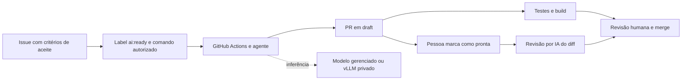

# Issue to PR AI

Template de desenvolvimento orientado por issues: um colaborador descreve a tarefa, um agente
implementa em uma branch, a CI valida o código e uma pessoa decide o merge.

Inclui uma API de catálogo funcional, integração com OpenCode e Claude Code,
revisão por IA e um perfil opcional de inferência com vLLM no Kubernetes.

Repositório: [lucasnscr/issue-to-pr-ai](https://github.com/lucasnscr/issue-to-pr-ai).



## Executar localmente

Requisitos: Docker com Compose. Para executar testes ou rodar a JVM diretamente, Java 21.
O Maven Wrapper baixa a versão de Maven configurada no projeto.

```sh
docker compose up --build -d
curl --fail http://localhost:8080/actuator/health/readiness
```

Acesse o [Swagger UI](http://localhost:8080/swagger-ui.html) e o
[OpenAPI JSON](http://localhost:8080/v3/api-docs).

```sh
curl --fail -X POST http://localhost:8080/api/products \
  -H 'Content-Type: application/json' \
  -d '{"sku":"BOOK-001","name":"Kubernetes na prática","category":"books","price":99.90}'

curl --fail 'http://localhost:8080/api/products?page=0&size=10'
```

O Compose usa credenciais locais de demonstração e publica portas apenas em `127.0.0.1`.
Copie `.env.example` para `.env` se precisar ajustar credenciais ou a porta da API.
O volume preserva o catálogo entre reinícios. `docker compose down` encerra os serviços.

Para rodar a API fora de um container:

```sh
docker compose up -d postgres
./mvnw -pl apps/catalog-api spring-boot:run
```

## Validar

Além de Java 21 e Docker, os checks do repositório usam Node.js 22+ e Python 3.10+.

```sh
./mvnw -B -ntp verify
node --test scripts/tests/*.test.cjs
python3 -m venv .venv
.venv/bin/pip install -r requirements-dev.txt
make check
```

`verify` executa testes unitários e de integração HTTP contra PostgreSQL em Testcontainers,
incluindo migrations, validação, paginação, conflitos e rollback. Docker precisa estar ativo;
falhas de infraestrutura não são convertidas em testes ignorados. `./mvnw test` executa somente
os testes unitários. Os relatórios ficam em `apps/catalog-api/target`.

Consulte o [registro de verificação local](docs/verification.md) para os resultados e limites da validação.

## Ativar no GitHub

Os workflows de IA começam **desativados**. A aplicação e a CI funcionam sem credenciais de IA.
As mudanças são entregues em branch dedicada e PR em draft. A primeira implementação usa
`feat/initial-template`, com destino em `main`; o commit inicial de `main` serve apenas como
base vazia para essa PR. Siga o [guia de configuração](docs/setup-cloud.md).

O [teste real antes do merge](docs/setup-cloud.md#teste-real-antes-do-primeiro-merge) usa um push
da branch `ai/live-test` para executar uma tarefa com OpenCode e um modelo real. O workflow
valida o resultado com testes PostgreSQL antes de publicar uma PR em draft contra
`feat/initial-template`. Configure primeiro `ANTHROPIC_API_KEY`; o modelo roda sem token
GitHub, e um job separado publica o resultado. A existência do workflow não comprova uma
execução: consulte o run e a PR gerados para verificar o resultado.

Após configurar `ANTHROPIC_API_KEY` e as variáveis de ativação, adicione a label `ai:ready`
a uma issue e comente um dos comandos:

```text
/oc implemente esta issue seguindo os critérios de aceite
@claude implemente esta issue seguindo os critérios de aceite
```

Somente colaboradores com escrita podem acionar implementações. PRs de forks não são executadas
com credenciais. Claude Code é uma opção adicional ativada por `CLAUDE_ENABLED`.
OpenCode também pode usar `vllm/qwen-coder`, sem chamada à Anthropic nesse perfil.

O caminho principal usa `opencode github run` com CLI fixada, e o alternativo usa a Action
oficial do Claude Code. A revisão usa OpenCode sem ferramentas habilitadas: recebe o patch,
gera o texto, e uma etapa separada publica o comentário. Ela não roda o código da PR.

## API

| Método | Endpoint | Resultado |
|---|---|---|
| POST | `/api/products` | Cria produto; `201` e `Location` |
| GET | `/api/products?page=0&size=20` | Lista paginada, ordenada por criação e ID |
| GET | `/api/products/{id}` | Consulta por UUID |
| PUT | `/api/products/{id}` | Substitui campos editáveis |
| DELETE | `/api/products/{id}` | Exclui; `204` |

SKU: 2–40 caracteres alfanuméricos, `_` ou `-`, começando por um alfanumérico; armazenado em maiúsculas.
Nome e categoria são obrigatórios; categoria é normalizada para minúsculas. Descrição é opcional.
Preço: de `0.01` a `9999999999.99`, com até duas casas decimais. Páginas começam em zero e têm tamanho de 1 a 100.
Erros usam `application/problem+json`: `400` para entrada inválida, `404` para produto ausente,
`409` para SKU duplicado. A API é uma aplicação de demonstração sem autenticação de usuários.

## Conteúdo

- `apps/catalog-api`: aplicação, migrations, testes e documentação OpenAPI.
- `.github/workflows`: CI, implementação e revisão por IA.
- `.github/scripts`: autorização, preparação do patch e publicação de revisão.
- `infra/kubernetes`: catálogo, inferência privada e exemplo de runners temporários com ARC.
- `docs`: [arquitetura](docs/architecture.md), [GitHub](docs/setup-cloud.md),
  [Kubernetes](docs/setup-kubernetes.md) e [roteiro de demonstração](docs/demo.md).
- `AGENTS.md` e `CLAUDE.md`: instruções compartilhadas de desenvolvimento.

## Referências

Projeto inspirado em [Continuous Development with Claude Code on GitHub](https://piotrminkowski.com/2026/07/02/continuous-development-with-claude-code-on-github/)
e [OpenCode on GitHub with Kubernetes](https://piotrminkowski.com/2026/10/07/opencode-on-github-with-kubernetes/), de Piotr Minkowski.
Configurações adaptadas às documentações oficiais de [OpenCode](https://opencode.ai/docs/github/),
[Claude Code Action](https://github.com/anthropics/claude-code-action) e [vLLM](https://docs.vllm.ai/en/latest/deployment/k8s/).

Licença [MIT](LICENSE).
