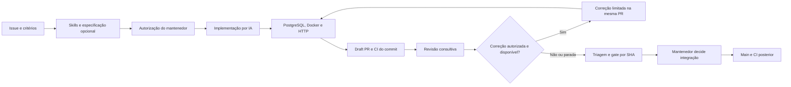

# Issue to PR AI

[](https://github.com/lucasnscr/issue-to-pr-ai/actions/workflows/ci.yml)

**Método de trabalho com IA, do requisito à entrega verificável no GitHub.**
Uma issue descreve o contrato; skills orientam a implementação; testes independentes
validam o código; revisão e correção limitada ajudam o mantenedor a decidir o merge.
O catálogo Java/Spring/PostgreSQL é o laboratório executável do método.

Comece pelo [índice da documentação](docs/README.md) ou pelo [quickstart](docs/quickstart.md).
O [modelo de trabalho](docs/modelo-de-trabalho.md) define papéis e critérios;
[CONTRIBUTING.md](CONTRIBUTING.md) descreve como evoluir a referência.

## O fluxo de trabalho



Cada etapa preserva escopo, permissões, proveniência e consumo. A IA não aprova nem decide
merge. O loop permite até duas correções, com reserva estimada e parada para intervenção.
CI verde, proposta de requisitos e parecer de modelo são evidências com alcances diferentes.

## Escolha sua jornada

| Objetivo | Entrada |
|---|---|
| Executar e validar sem IA | [Quickstart](docs/quickstart.md), [aplicação](apps/catalog-api/README.md) |
| Preparar uma tarefa e operar o método | [Modelo de trabalho](docs/modelo-de-trabalho.md), [issue → PR](docs/fluxo-issue-ate-pr.md) |
| Escolher as práticas do agente | [Catálogo](docs/skills-catalog.md), [manual das 11 skills](docs/skills-usage.md) |
| Configurar ou adotar em outro repo | [Bootstrap e doctor](docs/runbooks/adoption.md), [GitHub](docs/setup-cloud.md) |
| Entender arquitetura e limites | [Arquitetura](docs/architecture.md), [decisões](docs/decisions/README.md), [governança](docs/governance.md) |
| Resolver bloqueios e avaliar achados | [Operação](docs/runbooks/github-operations.md), [triagem](docs/review-triage.md) |
| Conferir resultados reais | [Validação da referência](docs/validacao-reference-method.md), [loop](docs/validacao-engineering-loop.md) |

## Executar localmente

Requisitos para a validação completa: Node.js 22+, Java 21, Python 3.10+, Docker/Compose e
kubectl. `gh` é necessário apenas para operações GitHub. O Maven Wrapper está no repositório.

```sh
make setup
make doctor
make verify
docker compose up --build -d
make acceptance
```

`make doctor` verifica fontes/configuração. `make verify` executa os checks locais e
Maven com PostgreSQL real. `make acceptance` usa a aplicação de laboratório já iniciada;
CI também constrói a imagem e verifica HTTP. Consulte os [comandos e seus alcances](docs/runbooks/validation.md).

## Ativar no GitHub

A aplicação e a CI funcionam sem credencial de IA. Em um novo repositório, os fluxos de IA
ficam desligados até configurar explicitamente secrets e variáveis. O bootstrap não os ativa.

```sh
# Prévia, sem consultar ou alterar o GitHub
node scripts/bootstrap-repository.mjs --repo OWNER/REPOSITORY

# Aplicação explícita de descrição, template, topics e labels
node scripts/bootstrap-repository.mjs --repo OWNER/REPOSITORY --apply

# Leitura de configuração efetiva; não chama o modelo
node scripts/repository-doctor.mjs --github --repo OWNER/REPOSITORY --profile base
```

Complete [proteção, responsáveis e permissões](docs/runbooks/adoption.md) e os perfis de
[OpenCode/Claude](docs/setup-cloud.md). Secrets são provisionados no GitHub, sem enviar valores ao chat.
Um template não transfere configurações de conta/repositório nem valida outro ambiente automaticamente.

## Usar como modelo de trabalho

1. Abra uma issue de funcionalidade, defeito ou manutenção, com escopo e critérios.
2. Escolha skills. Com configuração ativa, `/ai-spec` ajuda a esclarecer decisões antes do código.
3. Um colaborador com escrita incorpora as decisões, adiciona `ai:ready` e comenta `/oc`
   ou `@claude` para tarefas compatíveis com o perfil Java.
4. Confira draft PR, manifesto das skills, relatórios, consumo e SHA. Revisão é consultiva;
   correção exige `AI_LOOP_ENABLED` e `ai:autofix` e preserva as tentativas consumidas.
5. Faça a triagem, decida o merge com os checks atuais e confira a CI da base.

Manutenção do método/workflows/infraestrutura segue uma PR conduzida pelo mantenedor.
A seleção inclui Superpowers, grill-me e Graphify, além das práticas Java/PostgreSQL/testes.
O [manual](docs/skills-usage.md) explica o efeito e o limite de cada skill. IDs e hashes
acompanham as fases; o catálogo não concede ferramentas nem instala plugins globais.

## Organização

| Caminho | Papel |
|---|---|
| `apps/` | Aplicação de laboratório |
| `.github/` | Formulários, ownership, workflows e controles GitHub |
| `scripts/` | Execução, validação, telemetria, diagnóstico e bootstrap |
| `config/` | Método, políticas, catálogo e configuração desejada |
| `skills/` e `evals/` | Práticas por fase e avaliação versionada |
| `infra/` | Manifests e exemplos de ambientes |
| `docs/` | Guias, decisões, runbooks e evidências |

O [mapa completo](docs/README.md#mapa-da-implementação) relaciona responsabilidades e como
alterá-las. Links e âncoras locais são validados na CI; fontes de terceiros preservadas
em `skills/upstream/` não são tratadas como uma árvore de documentação completa.

## API

CRUD, categorias completas, filtros por categoria/preço, paginação, ordenação e interface
web estão documentados no [contrato da aplicação](apps/catalog-api/README.md).
O produto é demonstrativo e não tem autenticação de usuários. Use dados sintéticos.

## Evidência e evolução

A [validação da referência](docs/validacao-reference-method.md) registra testes e limites.
Há evidências históricas de [implementação/revisão/correção](docs/validacao-engineering-loop.md),
[skills](docs/validacao-skills.md) e [avaliação/triagem](docs/validacao-review-quality-triage.md).
Um resultado observado não demonstra ausência universal de defeitos ou ganho de produtividade.

O perfil de aplicação Kubernetes usa CPU/kind. vLLM/GPU, ARC, controles corporativos e a
integração autenticada do Cursor continuam exigindo validação própria. Veja o [roadmap](docs/roadmap.md).
Quotas compartilhadas e workflows genéricos para outras stacks não foram implantados.

## Referências

Inspiração: [Continuous Development with Claude Code on GitHub](https://piotrminkowski.com/2026/07/02/continuous-development-with-claude-code-on-github/)
e [OpenCode on GitHub with Kubernetes](https://piotrminkowski.com/2026/10/07/opencode-on-github-with-kubernetes/), de Piotr Minkowski.
Implementação e decisões estão na [arquitetura](docs/architecture.md).

Licença [MIT](LICENSE). Consulte [segurança](SECURITY.md) e [contribuição](CONTRIBUTING.md).
