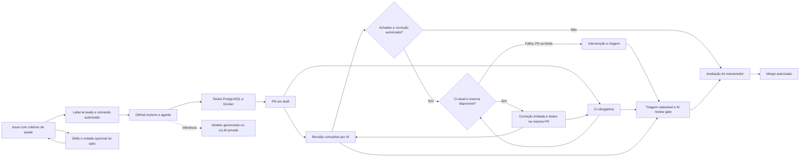

# Issue to PR AI

Template de desenvolvimento orientado por issues: um colaborador descreve a tarefa, um agente
implementa, testes com PostgreSQL e Docker validam o código antes da PR, e uma pessoa decide o merge.

Inclui uma API de catálogo funcional, integração com OpenCode e Claude Code,
revisão por IA, ciclo opcional de correção na mesma PR, skills selecionáveis por issue
e um perfil de inferência com vLLM no Kubernetes.

Repositório: [lucasnscr/issue-to-pr-ai](https://github.com/lucasnscr/issue-to-pr-ai).

Veja o [fluxo completo, da criação da issue à PR revisada](docs/fluxo-issue-ate-pr.md),
com os comandos, controles, evidências e procedimentos para retomar execuções bloqueadas.
O [modelo de trabalho](docs/modelo-de-trabalho.md) define papéis, critérios de entrada/saída
e triagem para equipes. A [arquitetura](docs/architecture.md) descreve a implementação;
o [roadmap](docs/roadmap.md) propõe como evoluir a referência para outros projetos.



Escolha práticas de **Superpowers**, **grill-me**, **Graphify** e Java/PostgreSQL no campo
**Skills** da issue. O comando opcional `/ai-spec` ajuda a esclarecer requisitos; a seleção
acompanha implementação, testes, revisão e correção, com hashes para auditoria.
Veja o [catálogo e os exemplos](docs/skills-catalog.md) e a
[validação da entrega](docs/validacao-skills.md).
O [manual das 11 skills](docs/skills-usage.md) detalha o uso e o efeito de cada uma.

## Interface web

A aplicação inclui uma interface em português servida pelo próprio Spring Boot.
Não requer dependências externas, login ou configuração adicional.

| URL | Descrição |
|---|---|
| `http://localhost:8080/` | Interface web do catálogo |
| `http://localhost:8080/swagger-ui/index.html` | Swagger / OpenAPI |
| `http://localhost:8080/actuator/health/readiness` | Health check |

A interface permite listar, filtrar (categoria, faixa de preço, ordenação), paginar,
cadastrar, editar e excluir produtos usando os endpoints da API existente.
Consulte [docs/frontend.md](docs/frontend.md) para o roteiro manual e limitações verificadas.

## Executar localmente

Requisitos: Docker com Compose. Para executar testes ou rodar a JVM diretamente, Java 21.
O Maven Wrapper baixa a versão de Maven configurada no projeto.

```sh
docker compose up --build -d
curl --fail http://localhost:8080/actuator/health/readiness
```

Acesse a [interface web](http://localhost:8080/), o
[Swagger UI](http://localhost:8080/swagger-ui/index.html) e o
[OpenAPI JSON](http://localhost:8080/v3/api-docs).

```sh
curl --fail -X POST http://localhost:8080/api/products \
  -H 'Content-Type: application/json' \
  -d '{"sku":"BOOK-001","name":"Kubernetes na prática","category":"books","price":99.90}'

curl --fail 'http://localhost:8080/api/products?page=0&size=10'

# Todas as categorias presentes, sem paginação de produtos
curl --fail 'http://localhost:8080/api/products/categories'

# Filtrar por categoria (case-insensitive, remove espaços externos)
curl --fail 'http://localhost:8080/api/products?category=books'

# Filtrar por faixa de preço (limites inclusivos, combinável com category)
curl --fail 'http://localhost:8080/api/products?minPrice=10.00&maxPrice=99.99'
curl --fail 'http://localhost:8080/api/products?category=books&minPrice=50.00'

# Ordenar por preço ascendente ou descendente (combinável com filtros e paginação)
curl --fail 'http://localhost:8080/api/products?sort=price,asc'
curl --fail 'http://localhost:8080/api/products?sort=price,desc'
curl --fail 'http://localhost:8080/api/products?category=books&sort=price,asc&page=0&size=10'
```

O Compose usa credenciais locais de demonstração e publica portas apenas em `127.0.0.1`.
Copie `.env.example` para `.env` se precisar ajustar credenciais ou a porta da API.
O volume preserva o catálogo entre reinícios. `docker compose down` encerra os serviços.

Para rodar a API fora de um container:

```sh
docker compose up -d postgres
./mvnw -pl apps/catalog-api spring-boot:run
```

## Validar

Além de Java 21 e Docker, os checks do repositório usam Node.js 22+ e Python 3.10+.

```sh
./mvnw -B -ntp verify
node --test scripts/tests/*.test.cjs
python3 -m venv .venv
.venv/bin/pip install -r requirements-dev.txt
make check
```

`verify` executa testes unitários e de integração HTTP contra PostgreSQL em Testcontainers,
incluindo migrations, validação, paginação, conflitos e rollback. Docker precisa estar ativo;
falhas de infraestrutura não são convertidas em testes ignorados. `./mvnw test` executa somente
os testes unitários. Os relatórios ficam em `apps/catalog-api/target`.

Consulte o [registro de verificação local](docs/verification.md) para os resultados e limites da validação.

## Ativar no GitHub

Os workflows de IA começam **desativados**. A aplicação e a CI funcionam sem credenciais de IA.
As mudanças são entregues em branch dedicada e PR em draft contra `main`.
As PRs de bootstrap e filtro de categoria já foram integradas. Siga o
[guia de configuração](docs/setup-cloud.md). O diagnóstico antigo `AI live test`
continua desativado como registro reproduzível da primeira experiência.

Após configurar `ANTHROPIC_API_KEY` e as variáveis de ativação, adicione a label `ai:ready`
a uma issue e comente um dos comandos:

```text
/oc implemente esta issue seguindo os critérios de aceite
@claude implemente esta issue seguindo os critérios de aceite
```

Somente colaboradores com escrita podem acionar implementações em issues abertas e autorizadas.
Comentários em PRs não iniciam implementações. Claude Code é uma opção adicional ativada por `CLAUDE_ENABLED`.
OpenCode também pode usar `vllm/qwen-coder`, sem chamada à Anthropic nesse perfil.

Os comandos usam as CLIs fixadas em modo não interativo, com publicação isolada do agente.
A inferência não recebe um token GitHub no ambiente. O workflow valida o escopo, roda Maven
com PostgreSQL real, constrói a imagem e testa a API antes de publicar a PR. A CI é disparada
explicitamente para validar o commit publicado, inclusive quando eventos de PR da automação
aguardam aprovação de execução no GitHub.
A revisão usa OpenCode sem ferramentas habilitadas: recebe o patch,
gera o texto, e uma etapa separada publica o comentário. Ela não roda o código da PR.

Com `AI_LOOP_ENABLED=true` e a label `ai:autofix`, os achados estruturados retornam a um
agente de correção. O ciclo faz até duas tentativas na mesma PR, com testes independentes,
controle de consumo e parada para intervenção. O mantenedor decide aprovação e merge.
Veja [ativação, limites e acompanhamento do engineering loop](docs/engineering-loop.md).
O [relatório do teste real](docs/validacao-engineering-loop.md) registra duas correções
automáticas, testes com PostgreSQL/Docker, consumo estimado e a parada para triagem dos pareceres.
Nesse laboratório o estado final foi `needs-human`: o limite funcionou e os achados finais
exigiram avaliação assistida. `ready-for-human` e CI verde não representam aprovação automática.

O check separado [AI review gate](docs/review-triage.md) exige revisão, CI e triagem válidas
para o commit atual, preservando tentativas e reservas. A [avaliação do revisor](docs/reviewer-evaluation.md)
mede qualidade com casos versionados; o primeiro teste real encontrou dois defeitos e um falso
positivo. Veja a [evidência de R1/R2](docs/validacao-review-quality-triage.md).

## Usar como modelo de trabalho

| Objetivo | Documento |
|---|---|
| Definir papéis, preparar issues e concluir entregas | [Modelo de trabalho](docs/modelo-de-trabalho.md) |
| Entender componentes, estados e separação de credenciais | [Arquitetura](docs/architecture.md) |
| Configurar GitHub e operar o ciclo | [Configuração](docs/setup-cloud.md) e [engineering loop](docs/engineering-loop.md) |
| Conferir o que foi executado | [Verificação](docs/verification.md) e [teste real](docs/validacao-engineering-loop.md) |
| Avaliar a qualidade do revisor com casos versionados | [Avaliação do revisor](docs/reviewer-evaluation.md) |
| Classificar achados e exigir liberação do commit | [Triagem rastreável](docs/review-triage.md) |
| Priorizar próximos incrementos | [Roadmap](docs/roadmap.md) |

O fluxo atual conhece os caminhos e validadores do catálogo Java. A adoção em outra aplicação
exige adaptação e validação próprias. Template com bootstrap, workflows reutilizáveis,
painel e quotas compartilhadas são propostas do roadmap.

Consulte [política e consumo](docs/governance.md), [Cursor como alternativa](docs/cursor.md),
[casos de uso em equipes de engenharia](docs/use-cases.md) e a [apresentação](docs/presentation/).
O custo registrado é uma estimativa do runtime, separado do faturamento do provedor.

## API

| Método | Endpoint | Resultado |
|---|---|---|
| POST | `/api/products` | Cria produto; `201` e `Location` |
| GET | `/api/products?page=0&size=20` | Lista paginada, ordenada por criação e ID |
| GET | `/api/products/categories` | Todas as categorias com produtos, sem duplicatas e em ordem alfabética; catálogo vazio retorna `[]` |
| GET | `/api/products?category=books` | Lista filtrada por categoria (opcional, case-insensitive) |
| GET | `/api/products?minPrice=10.00&maxPrice=99.99` | Lista filtrada por faixa de preço (limites inclusivos, combinável com `category`) |
| GET | `/api/products?sort=price,asc` | Lista ordenada por preço crescente (desempate por ID) |
| GET | `/api/products?sort=price,desc` | Lista ordenada por preço decrescente (desempate por ID) |
| GET | `/api/products/{id}` | Consulta por UUID |
| PUT | `/api/products/{id}` | Substitui campos editáveis |
| DELETE | `/api/products/{id}` | Exclui; `204` |

SKU: 2–40 caracteres alfanuméricos, `_` ou `-`, começando por um alfanumérico; armazenado em maiúsculas.
Nome e categoria são obrigatórios; categoria é normalizada para minúsculas. Descrição é opcional.
Preço: de `0.01` a `9999999999.99`, com até duas casas decimais. Páginas começam em zero e têm tamanho de 1 a 100.
Filtro `category`: opcional; a comparação ignora maiúsculas/minúsculas e remove espaços externos.
Categoria inexistente retorna página vazia. Parâmetro presente mas em branco retorna `400`.
Filtros `minPrice` e `maxPrice`: opcionais, independentes e combináveis entre si e com `category`.
Limites são inclusivos. Valores negativos, com mais de duas casas decimais, ou `minPrice > maxPrice` retornam `400`.
Paginação e totais são calculados somente sobre os produtos filtrados.
Parâmetro `sort`: opcional. Valores aceitos: `price,asc` e `price,desc`. Preços iguais são desempatados por ID ascendente.
Sem `sort`, a ordem padrão (data de criação e ID) é preservada. Qualquer outro valor retorna `400`.
Erros usam `application/problem+json`: `400` para entrada inválida, `404` para produto ausente,
`409` para SKU duplicado. A API é uma aplicação de demonstração sem autenticação de usuários.

## Conteúdo

- `apps/catalog-api`: aplicação, migrations, testes e documentação OpenAPI.
- `.github/workflows`: CI, implementação e revisão por IA.
- `.github/scripts`: autorização, preparação do patch e publicação de revisão.
- `infra/kubernetes`: catálogo, inferência privada e exemplo de runners temporários com ARC.
- `docs`: [arquitetura](docs/architecture.md), [GitHub](docs/setup-cloud.md),
  [Kubernetes](docs/setup-kubernetes.md) e [roteiro de demonstração](docs/demo.md).
- `AGENTS.md` e `CLAUDE.md`: instruções compartilhadas de desenvolvimento.

## Referências

Projeto inspirado em [Continuous Development with Claude Code on GitHub](https://piotrminkowski.com/2026/07/02/continuous-development-with-claude-code-on-github/)
e [OpenCode on GitHub with Kubernetes](https://piotrminkowski.com/2026/10/07/opencode-on-github-with-kubernetes/), de Piotr Minkowski.
Configurações adaptadas às documentações oficiais de [OpenCode](https://opencode.ai/docs/github/),
[Claude Code Action](https://github.com/anthropics/claude-code-action) e [vLLM](https://docs.vllm.ai/en/latest/deployment/k8s/).

Licença [MIT](LICENSE).
