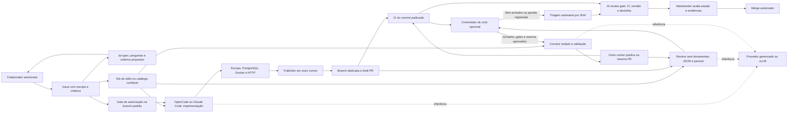
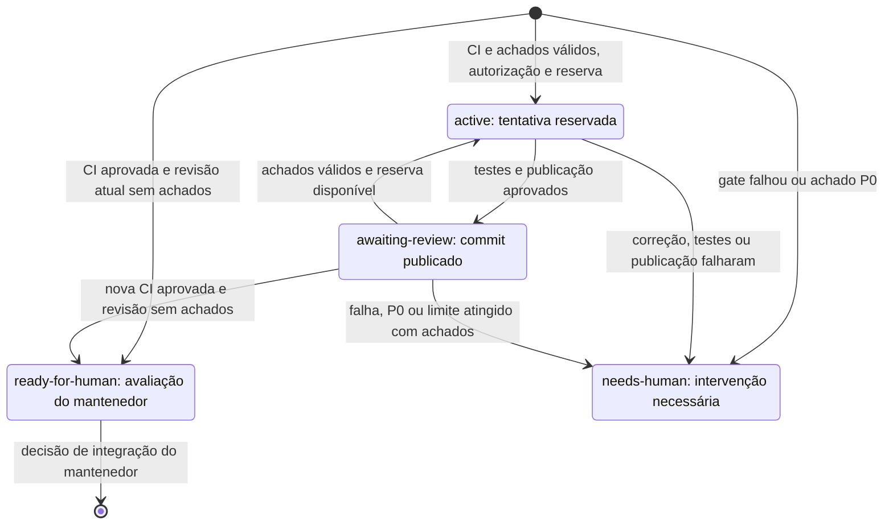

# Arquitetura e decisões

O [Issue to PR AI](https://github.com/lucasnscr/issue-to-pr-ai) implementa um fluxo de
desenvolvimento orientado por issues: geração de código, validação independente, draft PR,
revisão estruturada e correção opcional na mesma branch. A aprovação e o merge pertencem ao
mantenedor. O [modelo de trabalho](modelo-de-trabalho.md) define como uma equipe opera esse fluxo;
o [roadmap](roadmap.md) distingue as próximas propostas do comportamento implementado.
O [catálogo de skills](skills-catalog.md) fornece instruções versionadas por fase e uma
rodada opcional de especificação antes da autorização para implementar.
O [índice da referência](README.md) organiza componentes e jornadas. As
[decisões registradas](decisions/README.md) documentam separação de controle/candidata,
evidência por commit e adoção explícita.

## Componentes e responsabilidades

| Componente | Implementação | Responsabilidade |
|---|---|---|
| Especificação | `ai-specification.yml`, `specification.cjs`, `run-specification.mjs` | Perguntas e proposta por comando autorizado; publicação revalida issue e comentário |
| Skills | `skills.cjs`, `skills-catalog.json`, `skills/` | Selecionar por fase, verificar integridade e registrar versões/hashes |
| Grafo opcional | `prepare-skill-graph`, `graphify-context.py`, `attach-skill-graph.mjs` | Executar Graphify AST sem backend LLM somente na base confiável e fornecer resumo limitado |
| Autorização da tarefa | `ai-implement.yml`, `authorize.cjs`, `prepare-implementation.cjs` | Consultar ator, comando, issue, labels e SHA da base |
| Implementação | `run-implementation.mjs` | Executar a CLI escolhida sob política, sem publicar código |
| Validação e primeira publicação | `validate-agent-changes.mjs`, jobs de `ai-implement.yml` | Validar aplicação e testes; outro runner cria a draft PR |
| Revisão | `ai-review.yml`, `review-context.cjs`, `run-review.mjs`, `review-report.cjs`, `publish-review.cjs` | Preparar contexto confiável, validar JSON e publicar parecer associado ao SHA |
| Avaliação do revisor | `ai-review-evaluation.yml`, `evaluate-reviews.mjs`, dataset versionado | Medir verdadeiros/falsos positivos e negativos, com proveniência e consumo |
| Triagem e liberação | `ai-review-gate-events.yml`, `ai-review-gate.yml`, `ai-review-gate-check.yml`, `review-triage.cjs`, `review-gate.cjs` | Registrar decisões autorizadas, publicar decisão por SHA e verificá-la em job nativo obrigatório, sem executar código candidato |
| Controle do ciclo | `ai-correct.yml`, `engineering-loop.cjs` | Verificar procedência da revisão, CI, autorização, escopo e reservas |
| Correção | `run-correction.mjs`, `validate-correction.mjs` | Editar fonte/testes/docs em diretório isolado; validar o patch antes de publicar |
| CI | `ci.yml` | Revalidar scripts/configuração, API/PostgreSQL e aplicação em Docker |
| Diagnóstico/adoção | `repository-doctor.mjs`, `bootstrap-repository.mjs`, `repository.json` | Inspecionar configuração sem mutações; aplicar somente metadados/topics/labels com ação explícita |
| Qualidade da documentação | `validate-docs.mjs`, índice, ADRs e runbooks | Validar links/âncoras locais e manter navegação e responsabilidade claras |
| Catálogo de demonstração | Java 21, Spring Boot, PostgreSQL e Flyway | Fornecer uma aplicação real para tarefas verificáveis |

Os workflows ficam em [`.github/workflows`](../.github/workflows/) e os controles em
[`.github/scripts`](../.github/scripts/) e [`scripts`](../scripts/).

## Entrada e primeira entrega

Antes da implementação, `/ai-spec` em issue aberta pode produzir até cinco perguntas e dez
critérios propostos. Exige escrita e `AI_SPEC_ENABLED=true`, além de `AI_ENABLED=true`.
O agente `specifier` mantém todas as ferramentas negadas e usa política de consumo de
especificação. Cada rodada depende de novo comando humano. Não altera a descrição ou labels
nem inicia implementação. A seleção do formulário permite Superpowers, grill-me e Graphify,
além das práticas Java/PostgreSQL/testes/revisão; o guia documenta fases e padrões.

`issue_comment: created` reconhece `/oc`, `/opencode` ou `@claude` como primeira expressão
do comentário. O gate exige uma issue aberta com `ai:ready`, ator humano e permissão atual
`write`, `maintain` ou `admin`. Comentários em PRs não iniciam implementações. A variável
`CLAUDE_ENABLED` libera o caminho adicional do Claude Code.

O job parte do SHA atual da branch padrão, usa instruções confiáveis e limita alterações
a fonte, testes e Markdown. A implementação atual exige Java de produção e um teste Java
`*IT.java`; tarefas somente de documentação, dependências ou infraestrutura seguem uma PR
conduzida pelo mantenedor. O validador não é um adaptador genérico para qualquer linguagem.

Depois da geração, Maven executa testes com PostgreSQL real; Docker e critérios HTTP
independentes verificam a aplicação empacotada. Um runner novo reaplica e confere o patch,
publica `ai/issue-NUMERO-RUN_ID` e abre uma draft PR vinculada por `Closes #NUMERO`.
O publisher transfere `ai:ready` e, quando autorizada na issue, `ai:autofix` para a PR.
CI e revisão são solicitadas explicitamente.

O loader acrescenta somente recursos aprovados de cada fase, com hashes verificados. O
publisher registra IDs no corpo da PR usando catálogo da base, não artefatos do modelo.
Revisão/correção revalidam esses IDs no catálogo confiável de cada execução e preservam
`skills-manifest.json`. Um ID não permite carregar caminhos ou texto da PR como instrução.
Graphify, quando selecionado, roda antes da inferência sobre uma cópia somente de fontes
versionadas da base limpa: até 200 arquivos, 120 segundos e 4.000 bytes de contexto.
Ambiente sem credenciais, `GRAPHIFY_BACKEND=none` e `--code-only` impedem fallback semântico;
o helper rejeita tokens de modelo, procedência divergente e falhas de extração.

## Revisão e procedência do parecer

O revisor usa checkout confiável e dispatch na branch padrão, inclusive em revisões sem
corretor. O código do head não é executado por essa etapa. O contexto contém o patch completo
e trechos limitados da base, incluindo setup de testes e os normalizadores de produto/DTO.
O patch pode ter até 96.000 bytes e o contexto total, incluindo skills e grafo opcional,
até 112.000 bytes. Conteúdo incompleto,
binário ou acima do limite é rejeitado, sem truncamento silencioso.

O agente `reviewer` tem todas as ferramentas negadas. Sua resposta é validada como
`{summary, findings}`; cada achado contém prioridade P0–P3, título, evidência, arquivo e linha
de um trecho do patch. Uma etapa separada publica um comentário com SHA e envelope estruturado
de repositório, PR, execução, tentativa e consumo. O controlador aceita somente dados do bot
provenientes de uma revisão confiável e concluída na branch padrão.

Uma revisão publicada para o mesmo SHA impede nova inferência. Quando possui envelope
estruturado válido, o dispatch pode reutilizá-la para o ciclo autorizado. Texto livre antigo
continua consultivo. Resultados de um SHA que deixou de ser atual são descartados.

## Gatilhos e autorização do ciclo

Os caminhos de revisão exigem `AI_ENABLED=true` e `AI_REVIEW_ENABLED=true`, além das
condições da tabela. Correções exigem também `AI_LOOP_ENABLED=true` e a autorização da PR.

| Entrada | Condições e efeito |
|---|---|
| `/ai-spec` em issue | Issue aberta, ator autorizado, `AI_ENABLED` e `AI_SPEC_ENABLED`; comenta proposta sem liberar implementação |
| Comando em issue | `AI_ENABLED=true`, issue aberta com `ai:ready`, ator autorizado; inicia implementação |
| Evento automático de PR | Mesmo repositório, fora de draft, `ai:ready`, abertura/novo commit/reabertura/saída de draft; encaminha revisão para dispatch na branch padrão |
| Evento de PR com correção autorizada | Condições anteriores, `AI_LOOP_ENABLED=true` e `ai:autofix`; após o parecer, o controlador avalia a correção |
| Dispatch de revisão | PR aberta do mesmo repositório; aceita draft; ator manual precisa de escrita |
| Dispatch de correção | `AI_ENABLED`, `AI_REVIEW_ENABLED` e `AI_LOOP_ENABLED` ativos, `ai:autofix`, revisão confiável e SHA atual; avalia se pode reservar uma tentativa |

Adicionar uma label isoladamente não dispara implementação ou revisão. O ciclo é
serializado por PR, sem cancelar uma chamada já iniciada. A branch precisa conter a versão
atual da branch padrão. Antes da inferência e antes do push, o controlador reconsulta a
autorização, o head e a base. Um achado P0 exige intervenção antes de liberar o corretor.

O publisher usa `workflow_dispatch` porque eventos de automação com `GITHUB_TOKEN`
possuem regras próprias: certos eventos de PR podem aguardar aprovação de execução, enquanto
dispatch inicia a execução explicitamente. O controlador prefere a CI disparada para o SHA
correto, evitando confundir uma execução pendente de aprovação com a validação realizada.
Veja a [documentação de gatilhos do GitHub](https://docs.github.com/en/actions/how-tos/write-workflows/choose-when-workflows-run/trigger-a-workflow).

## Correção, validação e publicação

1. **Preparar:** confirmar revisão estruturada, PR atual, base atualizada, escopo permitido e
   CI bem-sucedida do SHA revisado; aguardar essa CI por até 600 segundos.
2. **Reservar:** persistir tentativa e orçamento no comentário de acompanhamento antes de
   fornecer a credencial do modelo. Falhas, cancelamentos e reexecuções preservam a reserva.
3. **Propor:** o OpenCode recebe os achados e os critérios originais como dados, em diretório
   novo com fonte/testes/Markdown, sem `.git` ou configurações da PR. Comandos, ferramentas
   de rede, subagentes, plugins, LSP e formatadores ficam desabilitados.
4. **Validar:** exigir alteração de produção e teste de regressão; verificar caminhos,
   modos de arquivos e patch; executar Maven/PostgreSQL, Docker e aceitação HTTP confiável.
5. **Publicar:** outro runner reaplica e confere o patch e as condições atuais da PR. Faz
   push normal na mesma branch e solicita CI e revisão para o novo commit.

O agente de correção usa OpenCode mesmo quando a implementação inicial veio de `@claude`.
Os jobs de correção atuais usam `ubuntu-latest`; o uso desses jobs com vLLM privado/ARC
permanece sem implantação validada. Instruções operacionais: [engineering-loop.md](engineering-loop.md).

## Estados e decisão de integração

| Estado | Significado operacional |
|---|---|
| `active` | Há tentativa reservada; a execução indicada deve ser acompanhada |
| `awaiting-review` | A correção foi publicada; falta avaliar a nova CI e revisão |
| `ready-for-human` | CI passou e a revisão atual não trouxe achados; o mantenedor decide a entrega |
| `needs-human` | O controlador registrou uma condição de parada; exige inspeção das evidências |

O diagrama mostra o ciclo automático; a triagem posterior a uma parada fica com o mantenedor.
O estado é persistido em um comentário do bot, com tentativas `reserved`, `published` ou
`failed`, SHAs, execuções e estimativas. As tentativas não são zeradas ao remover/recolocar
labels. O modelo não muda o draft, não aprova e não integra código.

**Estado do ciclo e conclusão do workflow são sinais diferentes.** Um job pode concluir com
sucesso técnico depois de registrar `needs-human`. O check separado `AI review gate` exige
revisão confiável e CI do SHA atual, decisões autorizadas sobre os achados e reconhecimento
explícito de uma parada após terminar as correções. Novo SHA invalida decisões anteriores;
remover labels não apaga a autorização registrada. PRs nunca autorizadas para IA recebem
um caminho manual explícito. Veja [triagem e proteção de branch](review-triage.md).

Os eventos usam somente metadados e código da branch padrão. Um worker serializado reconcilia
todas as PRs abertas; para PRs no mesmo SHA, prevalece o resultado mais restritivo. Uma nova
autorização/decisão invalida a geração anterior do check antes da reconciliação. Falhas de
consulta bloqueiam. Recibos de triagem preservam ator, origem, hash, justificativa, revisão
e commit, sem alterar o histórico do controlador nem conceder tentativas adicionais.

`AI review decision` é o resultado detalhado pela Checks API. A proteção exige o job nativo
`AI review gate`, de `pull_request_target`: ele reconsulta os metadados atuais em modo
somente leitura e reprova em pendências/falhas. O reconciliador reexecuta o workflow nativo
do mesmo SHA/PR somente quando sua conclusão precisa mudar; o evento de conclusão permite
acompanhar uma execução já em andamento. Não há inferência nessa verificação.

## Limites e separação de credenciais

| Controle | Implementação atual |
|---|---|
| Cada rodada de especificação | 1 etapa, 540 segundos, estimativa USD 1; fora da reserva da PR |
| Implementação inicial | 35 etapas, 900 segundos, estimativa USD 5 |
| Cada revisão | 1 etapa, 540 segundos, estimativa USD 1 |
| Cada correção | 20 etapas, 600 segundos, estimativa USD 3 |
| Ciclo por PR | Até 2 correções; reserva estimada USD 9 para revisão inicial e duas correções/revisões |
| Patch corretivo | Até 25 arquivos e 60.000 bytes; fonte/testes/Markdown; migrations aplicadas preservadas |
| Estado e consumo | Comentário do bot por PR e agregados JSON por execução; artefatos com retenção de 14 dias |

As fontes são [`config/ai-policy.json`](../config/ai-policy.json) e
[`config/engineering-loop.json`](../config/engineering-loop.json). Estimativas e reservas são
controles operacionais; um teto financeiro efetivo depende do provedor/gateway. Consumo
indisponível não é zero. Revisões manuais externas ao ciclo também podem gerar consumo.

Inferência recebe a credencial do provedor, sem token GitHub no ambiente do subprocesso.
Testes posteriores não recebem a credencial do modelo. Os publishers com escrita rodam
separados e não executam a aplicação candidata. As etapas que registram estado têm permissão
para comentar na PR; o corretor mantém permissões de leitura. O diretório e as permissões
de ferramentas reduzem o escopo da geração, sem transformar instruções em uma garantia de
isolamento de sistema operacional. Detalhes de operação e consumo: [governance.md](governance.md).

## Aplicação e infraestrutura de referência

O catálogo contém CRUD, filtros, paginação, ordenação e interface web. O endpoint
`GET /api/products/categories` consulta todas as categorias por
`SELECT DISTINCT LOWER(TRIM(p.category))`, com ordenação no banco, sem paginação dos produtos.
O catálogo vazio retorna `[]`; excluir a última ocorrência retira a categoria do resultado.
Os testes verificam mais de 20 produtos e dados inseridos diretamente no PostgreSQL.

Compose executa API e banco localmente. O perfil Kubernetes da aplicação foi validado em
kind, com PVC e persistência após substituir Pods. vLLM fornece inferência em processo
separado e requer o ambiente de GPU escolhido; ARC fornece runners. Manifestos de vLLM/ARC
foram preparados, mas sua implantação e o enforcement de NetworkPolicy permanecem pendentes.
Backup, autenticação de usuários, TLS externo e HA exigem uma implantação própria.

## Evidência e evolução

A [PR #32](https://github.com/lucasnscr/issue-to-pr-ai/pull/32) validou duas correções reais
na mesma PR, 84 testes Java, 97 Node, PostgreSQL/Docker e estimativa total de USD 0.53927370.
A candidata inicial continha um defeito controlado; esse laboratório não repetiu a geração
inicial por comando na issue. Ele terminou em `needs-human` por limite com achados
especulativos persistentes, seguido de triagem assistida sob autorização do mantenedor.
O [relatório completo](validacao-engineering-loop.md) preserva resultados e SHAs; os números
são evidência daquela execução, não garantia de custo, produtividade ou autonomia futuros.

O diagnóstico anterior `AI live test` permanece histórico e desativado. Para a operação
atual, consulte o [fluxo completo](fluxo-issue-ate-pr.md), o [modelo de trabalho](modelo-de-trabalho.md)
e o [roadmap de evolução](roadmap.md).
