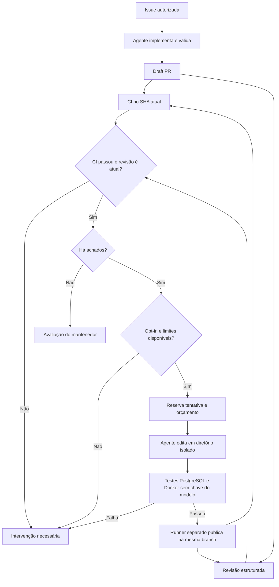

# Engineering loop: revisão, correção e nova validação

O ciclo opcional devolve os achados estruturados de uma revisão ao agente. Ele propõe uma
correção na **mesma PR**, executa a validação e solicita outra revisão. O mantenedor continua
responsável pela aprovação e pelo merge. A automação não muda uma draft para pronta.



## Ativação

Os workflows e scripts precisam estar na branch padrão. O template mantém o recurso
desativado quando a variável não existe. Configure:

| Configuração | Valor |
|---|---|
| Variable `AI_ENABLED` | `true` |
| Variable `AI_REVIEW_ENABLED` | `true` |
| Variable `AI_LOOP_ENABLED` | `true` |
| Variable `CORRECTION_MODEL` | Opcional; padrão `anthropic/claude-sonnet-4-6` |
| Secret do provedor | O mesmo já usado pela implementação/revisão |
| Label na PR | `ai:autofix` |

Crie a label uma vez, se necessário:

```sh
gh label create ai:autofix --color 5319E7 --description 'Autoriza o ciclo limitado de revisão e correção'
```

Para uma nova funcionalidade, adicione `ai:ready` e `ai:autofix` à **issue** e comente `/oc`
ou `@claude`. O publisher consulta novamente a issue e transfere a autorização de correção
para a draft PR. A implementação inicial pode usar qualquer um desses dois agentes; o
corretor desta versão usa **OpenCode** com o modelo configurado em `CORRECTION_MODEL`.
Os jobs de correção usam runners `ubuntu-latest`. Conectividade com vLLM privado e execução
desses jobs em runners ARC ainda precisam de validação.

Para uma PR existente, adicione `ai:autofix` e solicite a revisão confiável:

```sh
gh pr edit NUMERO --add-label ai:autofix
gh workflow run ai-review.yml --ref main -f pull_request=NUMERO
```

O dispatch aceita draft. Para revisões automáticas em abertura, novos commits, reabertura
ou saída de draft, a PR precisa também de `ai:ready` e estar fora de draft. Quando o ciclo
está ativo, esses eventos são encaminhados ao revisor da branch padrão. Adicionar uma label
isoladamente não é um gatilho. Uma revisão do mesmo SHA já publicada não faz outra chamada
ao modelo. Se ela tem dados estruturados de uma execução confiável, o dispatch reutiliza esse
parecer para iniciar o ciclo autorizado, sem zerar tentativas anteriores. Pareceres antigos
em texto livre não autorizam correção; nesses casos, avalie manualmente ou solicite revisão
de um novo commit.

## Como cada etapa funciona

1. **Revisão:** recebe o patch completo como dados e retorna JSON com resumo, prioridade,
   arquivo, linha do trecho modificado e evidência de cada achado. O parser rejeita texto livre,
   locais inventados, prioridades desconhecidas e respostas fora dos limites. O comentário
   inclui os dados estruturados, SHA, número da PR, execução e estimativa de consumo.
2. **Autorização:** o workflow `AI engineering loop` só aceita dispatch na branch padrão,
   originado de uma revisão desse mesmo repositório e dessa branch. Reconsulta a PR e a
   autorização, descarta SHAs obsoletos e aguarda a CI daquele SHA por até dez minutos.
   A branch da PR precisa conter a versão atual da branch padrão.
   O workflow lê a descrição da PR e os critérios da issue vinculada por `Closes #N`,
   quando existir, e os fornece ao corretor somente como contexto da tarefa original.
3. **Reserva:** persiste a tentativa em um comentário do bot antes da inferência. Reexecução,
   cancelamento, remoção/reinclusão da label e falta de telemetria não zeram a contagem.
   O workflow é serializado por PR.
4. **Correção:** copia somente fonte/testes/Markdown para um diretório novo, sem `.git`,
   `.env`, plugins ou configurações da PR. Usa instruções confiáveis e permite leitura e
   edição dos caminhos autorizados. Comandos, rede via ferramentas, subagentes, LSP e
   formatadores ficam desabilitados. O subprocesso recebe somente as variáveis necessárias
   ao provedor e ao runtime, sem tokens do GitHub ou credenciais de nuvem do runner.
5. **Validação:** exige alteração de produção e teste de regressão, rejeita binários,
   symlinks, executáveis, mudanças em migrations existentes e caminhos fora do escopo.
   Executa Maven com PostgreSQL real, Docker e critérios HTTP independentes. A chave do
   provedor só é fornecida à etapa de geração, não às etapas de teste.
6. **Publicação:** um runner novo aplica e valida novamente o patch. Reconsulta label,
   SHA, branch e base antes de criar um commit e fazer push normal à branch da mesma PR.
   Não executa o código da PR com o token de escrita. Dispara CI e revisão explicitamente.
7. **Resultado:** uma revisão sem achados e CI aprovada produzem `ready-for-human` no
   comentário de acompanhamento. Isso não é `APPROVED`, não remove o draft e não faz merge.

O revisor continua consultivo. Achados podem ser falsos positivos; o corretor deve explicar
e parar se não houver defeito demonstrável, sem inventar uma alteração para satisfazer o loop.

## Limites e parada

As regras ficam em [config/engineering-loop.json](../config/engineering-loop.json) e
[config/ai-policy.json](../config/ai-policy.json).

| Limite | Valor |
|---|---|
| Correções automáticas por PR | 2, incluindo tentativas falhas ou canceladas |
| Cada correção | 20 etapas, 600 segundos, 750.000 unidades conservadoras de tokens, estimativa USD 3 |
| Cada revisão | 1 etapa, 540 segundos, 80.000 unidades, estimativa USD 1 |
| Reserva estimada do ciclo | USD 9: uma revisão inicial + duas reservas de correção e revisão |
| Patch de cada correção | Até 60.000 bytes e 25 arquivos |
| Escopo da PR e da correção | `apps/catalog-api/src`, `README.md` e Markdown em `docs/` |

As reservas não são devolvidas quando uma tentativa falha. Consumo reportado é registrado
separadamente; ausência de telemetria não significa custo zero. Esses valores são estimativas
observadas pelo supervisor, **não um teto de faturamento garantido**. Revisões manuais externas
ao ciclo também podem gerar consumo. Consulte a [política de consumo](governance.md).

O ciclo marca `needs-human` quando a CI falha/não termina, a revisão falha ou é inválida,
surge um achado P0, o agente não propõe uma correção válida, os testes falham, o escopo é
incompatível, a base muda, a publicação falha ou os limites acabam com achados persistentes.
PRs de infraestrutura, workflows ou dependências exigem tratamento pelo mantenedor.

Para parar novas correções de uma PR, remova `ai:autofix`. Para desligar o recurso, defina
`AI_LOOP_ENABLED=false`. Cancele também execuções já iniciadas em Actions. O gate consulta
novamente a label antes de liberar a chave e antes de publicar; ele não desfaz uma chamada
já aceita pelo provedor. Cancelamento pode deixar uma reserva em `active`; o comentário
e a execução identificada mostram a tentativa consumida para avaliação manual.

O estado não tem um comando automático de reset. Após uma parada, o mantenedor analisa os
artefatos e corrige a PR manualmente. Uma nova revisão sem achados com CI aprovada pode
registrar `ready-for-human` para o novo SHA, preservando o histórico e os limites consumidos.

## Verificação desta implementação

Os testes Node exercitam revisão estruturada, autorização, reserva, publicação simulada,
nova revisão sem achados, limite de duas correções, falhas e reexecução. O wrapper é exercitado
com um processo de modelo simulado que realmente edita arquivos num repositório Git temporário.
O CLI OpenCode fixado em `1.19.3` aceita a configuração do corretor com comandos/LSP/formatadores
desabilitados. Um teste adicional com esse CLI e endpoint HTTP local simulado confirmou edição
de produção/teste, bloqueio de escrita em workflow, ausência da ferramenta Bash e telemetria
completa. Esse endpoint não é um modelo real. Maven verifica a aplicação com PostgreSQL real;
lint valida os workflows.

Essas verificações **não demonstram um ciclo completo com o provedor no GitHub**. Esse teste
precisa ocorrer depois que os novos workflows entrarem na branch padrão, usando uma PR de
aplicação com defeito pequeno e reproduzível, `ai:autofix` e dados sintéticos. Confira o SHA de
cada parecer, o commit corretivo, os relatórios dos testes e o comentário de acompanhamento.

As escolhas de dispatch explícito e separação de privilégios seguem a documentação do
[GITHUB_TOKEN](https://docs.github.com/en/actions/concepts/security/github_token) e de
[uso seguro de Actions](https://docs.github.com/en/actions/reference/security/secure-use).
As permissões de ferramentas e a configuração do diretório isolado seguem as referências de
[permissões](https://opencode.ai/docs/permissions/) e [configuração do OpenCode](https://opencode.ai/docs/config/).
