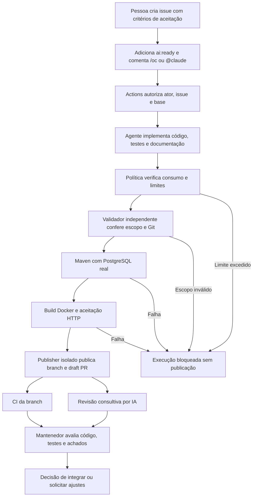

# Da criação da issue à pull request revisada

Este documento explica o fluxo implementado no [Issue to PR AI](https://github.com/lucasnscr/issue-to-pr-ai).
Uma pessoa descreve a mudança em uma issue; um agente implementa; etapas independentes validam o resultado;
um publisher abre uma draft PR; CI e revisão consultiva ajudam o mantenedor a avaliar a entrega.

A aplicação usada no laboratório é um catálogo de produtos em Java 21/Spring Boot, com PostgreSQL,
Flyway, Docker e Kubernetes local. O fluxo também serve como referência para outras aplicações,
mas os validadores atuais são específicos deste catálogo. O projeto não representa uma solução
aprovada pela B3 nem uma integração com seus sistemas internos.

## 1. Visão geral e responsabilidades



| Participante | Responsabilidade |
|---|---|
| Autor da issue | Descrever o problema, escopo e critérios verificáveis |
| Colaborador autorizado | Liberar a tarefa e acionar a execução |
| OpenCode ou Claude Code | Propor alterações na aplicação, testes e documentação |
| GitHub Actions | Aplicar os controles e executar as validações independentes |
| Publisher | Publicar somente o patch aprovado em uma branch e draft PR |
| Revisor por IA | Comentar possíveis defeitos do commit analisado |
| Mantenedor | Conferir os achados, revisar o código e decidir o merge |

OpenCode e Claude Code são ferramentas. O modelo é configurado separadamente; neste laboratório,
os dois caminhos já foram executados com `anthropic/claude-sonnet-4-6`.

## 2. Preparar o repositório

Os workflows devem existir na branch padrão, atualmente `main`. Em Settings → Secrets and variables → Actions:

| Configuração | Finalidade |
|---|---|
| Secret `ANTHROPIC_API_KEY` | Autenticar chamadas ao provedor Anthropic |
| Variable `AI_ENABLED=true` | Habilitar implementações autorizadas |
| Variable `CLAUDE_ENABLED=true` | Habilitar também o comando `@claude` |
| Variable `AI_REVIEW_ENABLED=true` | Habilitar revisão consultiva |
| Variables `OPENCODE_MODEL`, `CLAUDE_MODEL`, `REVIEW_MODEL` | Selecionar modelos permitidos pela política |
| Variable `AI_ACCEPTANCE_PROFILE=full` | Validar categoria, preço e ordenação no Docker |

Os modelos têm o padrão `anthropic/claude-sonnet-4-6` nos workflows. O publisher precisa poder criar PRs
com GitHub Actions. Secrets nunca entram na issue, no código ou na documentação.
O [guia de configuração](setup-cloud.md) detalha as permissões e o perfil opcional vLLM.

## 3. Criar uma issue executável

A descrição deve informar o comportamento desejado e como conferir o resultado. Exemplo:

```markdown
## Objetivo
Permitir consultar produtos por uma interface web servida pela aplicação existente.

## Escopo
HTML, CSS e JavaScript em apps/catalog-api/src/main/resources/static/catalog/.
Preservar a API REST, banco, workflows e infraestrutura.

## Critérios de aceitação
- A página apresenta produtos reais retornados por GET /api/products.
- Filtros e paginação preservam os parâmetros selecionados.
- Carregamento, lista vazia e erros têm mensagens visíveis.
- Os testes existentes continuam passando.

## Validação
Executar ./mvnw -B -ntp verify com PostgreSQL real.
Declarar quais interações de navegador foram efetivamente verificadas.
```

O exemplo é um recorte. Os critérios completos do frontend estão na [issue #21](https://github.com/lucasnscr/issue-to-pr-ai/issues/21).

O agente recebe título e descrição atuais da issue, preparados pelo workflow.
Comentários antigos e o texto depois de `/oc` não substituem os critérios da descrição.
Para mudar o escopo de uma retomada, edite a descrição antes de iniciar a nova execução.

## 4. Autorizar e acionar o agente

1. Manter a issue aberta.
2. Adicionar a label `ai:ready`.
3. Um colaborador com permissão `write`, `maintain` ou `admin` publica um novo comentário:

```text
/oc
```

Alternativas: `/opencode` seleciona OpenCode; `@claude` seleciona Claude Code, quando habilitado.
O comando deve ser a primeira expressão do comentário, seguida por espaço ou fim do texto.

Adicionar somente a label não inicia uma implementação. Editar um comentário antigo também não:
o evento configurado é `issue_comment: created`. Comentários em PRs não iniciam implementações.

Exemplo pela CLI autenticada como colaborador autorizado:

```sh
gh issue edit NUMERO --repo lucasnscr/issue-to-pr-ai --add-label ai:ready
gh issue comment NUMERO --repo lucasnscr/issue-to-pr-ai --body '/oc'
```

Cada novo comando autorizado pode iniciar outra execução com novo consumo. A serialização por issue
evita execução simultânea, mas não deduplica comandos de implementação. Aguarde o resultado antes de reenviar.

## 5. Conferir a autorização e fixar a base

O workflow [AI implementation](../.github/workflows/ai-implement.yml) começa pelo job `authorize`:

- Confere se a IA está habilitada e o comentário pertence ao ator do evento, identificado como `User`.
- Reconhece o comando e consulta as permissões atuais do colaborador no GitHub.
- Exige uma issue aberta com `ai:ready`, sem ser uma PR.

No job `implement`, as permissões, o estado e a label são consultados novamente antes da inferência.
O checkout usa a branch padrão com `persist-credentials: false`. Seu SHA deve coincidir com o commit
atual da base consultado pela API; uma divergência bloqueia a execução.

O workflow prepara um arquivo com a tarefa e as instruções confiáveis. O agente de implementação
não recebe um token GitHub no ambiente para publicar código. A credencial do modelo é fornecida
somente à etapa que executa a inferência.

## 6. Implementar sob limites de execução

O script [run-implementation.mjs](../scripts/run-implementation.mjs) seleciona a CLI fixada no workflow.
O agente lê `AGENTS.md`, altera código/testes/docs e executa Maven. A publicação fica a cargo do publisher.

O perfil `implementation` em [ai-policy.json](../config/ai-policy.json) estabelece:

| Controle | Limite |
|---|---|
| Etapas | 35 |
| Tempo de inferência | 900 segundos, ou 15 minutos |
| Custo estimado observado | USD 5 por execução |
| Unidades conservadoras de tokens | 1.500.000 |
| Saída da CLI | 12 MiB |
| Telemetria completa | Obrigatória para concluir com sucesso |

As unidades de tokens incluem entrada, saída, raciocínio e cache conforme a coleta da CLI.
Não são uma janela de contexto do modelo nem o total de tokens faturáveis. Leituras repetidas de cache
também entram no limite conservador. O custo registrado é uma estimativa do cliente, não uma fatura.

Os limites são observados durante ou ao concluir a execução, conforme o executor. Uma chamada já aceita
pelo provedor pode ultrapassar um limite observado. Um teto financeiro rígido exige controle no provedor
ou gateway. Consumo desconhecido permanece indisponível, e não zero.

Alterar somente o limite de tokens não altera os limites de tempo, etapas, custo, modelos ou revisão.
Uma configuração nova deve entrar na `main` antes da retomada. Detalhes: [governança](governance.md).

## 7. Validar o patch antes de publicar

O sucesso da CLI não basta. Etapas independentes precisam aprovar a entrega:

| Etapa | O que verifica |
|---|---|
| Escopo | Caminhos permitidos, até 25 arquivos, ausência de symlinks e HEAD preservado |
| Alteração de aplicação | Mudança em Java de produção e em teste Java `*IT.java` |
| Maven | Testes unitários e integração HTTP com PostgreSQL real via Testcontainers |
| Docker | Build da imagem e inicialização da aplicação empacotada com PostgreSQL |
| Aceitação HTTP | Smoke, categoria e, no perfil `full`, faixa de preço e ordenação |

O escopo permitido é `apps/catalog-api/src/main/`, `apps/catalog-api/src/test/`, `README.md`
e arquivos Markdown em `docs/`. Alterações de workflows, configuração de agentes ou infraestrutura
não são aceitas nesse caminho. Tarefas que exigem mudar esses controles precisam de uma entrega específica.

O workflow preserva os validadores confiáveis antes da inferência. Assim, o agente não pode trocar
os critérios independentes pelos próprios testes gerados. Falhas bloqueiam a publicação.

Testes de entrega de HTML/assets demonstram que esses recursos são servidos. Só uma verificação de
navegador demonstra interações JavaScript como cadastro, filtros, confirmação e navegação por teclado.
A PR deve distinguir esses resultados.

## 8. Publicar a draft PR em outro runner

Após as validações, o job `publish` recebe o patch em um runner novo. Ele faz checkout do SHA da base,
aplica o patch e executa novamente o validador de escopo. Não executa a aplicação gerada com a credencial de publicação.

Somente esse job recebe as permissões de escrita necessárias. Ele:

1. Cria a branch `ai/issue-NUMERO-RUN_ID`.
2. Faz commit e push do patch aprovado.
3. Abre uma **draft PR** contra a base, com `Closes #NUMERO` e link para a execução.
4. Dispara explicitamente a CI da branch e a revisão consultiva da PR.

O publisher decide quando publicar com base nos resultados do pipeline. A decisão não depende de
um comando de Git ou de GitHub escolhido pelo modelo. `Closes #NUMERO` vincula a entrega à issue;
a criação da draft PR não encerra a issue. O fechamento ocorre quando a PR é integrada à branch padrão.

## 9. Acompanhar a CI da PR

O workflow [CI](../.github/workflows/ci.yml) executa checks de scripts/configuração e a suíte Java com
PostgreSQL, build Docker e aceitação HTTP. Isso verifica o código publicado na branch, além da validação prévia.

```sh
gh run list --repo lucasnscr/issue-to-pr-ai --workflow ai-implement.yml --limit 5
gh pr checks NUMERO --repo lucasnscr/issue-to-pr-ai
```

Confira o SHA da PR e os jobs `Repository checks` e `Build and tests`. Um workflow verde isolado não
significa que houve implementação: um comentário comum pode executar somente `authorize`, deixando
`implement` e `publish` ignorados. Os relatórios e os jobs efetivamente executados são a evidência.

## 10. Executar a revisão consultiva por IA

CI e revisão são disparadas separadamente e podem executar em paralelo. O revisor não precisa
executar o código da PR para analisar o patch.

Há dois caminhos para iniciar [AI review](../.github/workflows/ai-review.yml):

| Caminho | Condições |
|---|---|
| Dispatch do publisher ou manual | Branch padrão, PR aberta do próprio repositório; permite draft. Ator manual precisa de escrita |
| Evento de PR | PR do próprio repositório, fora de draft, com `ai:ready`, em abertura, novo commit, reabertura ou saída de draft |

A label da issue não é copiada automaticamente para a PR pelo publisher. O dispatch inicial permite
analisar a draft sem essa label. Para os eventos automáticos posteriores, adicione a label na própria PR.
Adicionar apenas a label não é um evento configurado para iniciar revisão; use dispatch se necessário.
Novos commits em uma draft também precisam de dispatch ou de uma transição elegível para pronta.

```sh
gh workflow run ai-review.yml --repo lucasnscr/issue-to-pr-ai --ref main -f pull_request=NUMERO
```

O workflow usa ferramentas do checkout confiável da base. Ele obtém o patch pela API e acrescenta
trechos limitados de arquivos Java da base, principalmente setup e helpers de testes. O agente revisor
tem todas as ferramentas negadas: não faz checkout do head, não executa os testes e não altera o código.

Antes da inferência, o patch deve estar completo, ser textual e ter até 32.000 bytes. O contexto total
permanece abaixo de 40.000 bytes. Patches maiores, binários ou incompletos exigem revisão manual.

O perfil `review` permanece limitado a uma etapa, 540 segundos, estimativa de USD 1, 80.000 unidades
de tokens e 4 MiB de saída, com telemetria obrigatória.

## 11. Publicar e interpretar a revisão

Uma etapa separada publica o resultado como **comentário na conversa da PR**, com o SHA analisado.
É um parecer consultivo; não é uma aprovação formal `APPROVED` nem um bloqueio formal `CHANGES_REQUESTED`.

Antes de publicar, o workflow consulta a PR novamente. Se o SHA mudou ou a PR foi fechada,
descarta o resultado antigo. Um comentário do bot com o marcador do mesmo SHA impede nova inferência
para aquele commit. Um resultado ignorado por idempotência não representa uma nova revisão.

Para considerar a PR revisada:

- Conferir se há comentário do bot associado ao SHA atual e se a geração realmente executou.
- Ler os achados no contexto do código completo e reproduzir os problemas relevantes.
- Conferir CI, critérios de aceitação e limitações declaradas na PR.
- Registrar a avaliação do mantenedor e solicitar ajustes ou decidir a integração.

Uma execução real anterior levantou hipóteses equivocadas sobre código fora do diff.
Trechos da base ajudam a reduzir esse problema, mas não eliminam falsos positivos ou defeitos omitidos.
Não há correção automática em resposta à revisão, aprovação pelo agente nem merge automático por IA.

A proteção da `main` exige PR e checks atualizados. Este laboratório de um mantenedor tem zero
aprovações adicionais obrigatórias; isso não comprova revisão humana independente. Uma equipe deve
definir seus responsáveis e a política de aprovação. A IA não altera essa proteção para entregar código.

## 12. Diagnosticar falhas e retomar

| Situação | Resultado | Procedimento |
|---|---|---|
| Comando, ator ou label inválidos | Implementação não inicia | Conferir permissão, issue aberta, label e novo comentário com comando inicial |
| Base mudou antes da preparação | Execução bloqueada | Iniciar uma execução nova na base atual |
| `TOKEN_LIMIT`, `STEP_LIMIT`, `TIMEOUT` ou `COST_LIMIT` | Sem publicação da proposta | Avaliar consumo; reduzir escopo ou revisar o controle por PR antes de retomar |
| Escopo inválido ou testes falham | Sem draft PR | Inspecionar evidências e corrigir a tarefa ou o patch em uma ação deliberada |
| Patch de revisão muito grande/incompleto | PR continua disponível, sem parecer da IA | Revisar manualmente ou dividir uma entrega futura |
| SHA mudou durante a revisão | Parecer antigo descartado | Revisar o commit atual por evento elegível ou dispatch |
| Mesmo SHA já revisado | Inferência ignorada | Consultar o comentário existente e seu SHA |

Os artefatos têm retenção de 14 dias. Consumo e resumo são coletados quando a etapa de inferência
começa. O patch candidato só é salvo depois que o agente conclui e o escopo é validado; uma interrupção
durante a inferência pode deixar apenas telemetria, sem código recuperável. Os relatórios de testes
só existem para etapas que efetivamente os executaram. Não se deve tratar ausência de relatório como aprovação.

### Exemplo real: bloqueio de tokens do frontend

A [execução 39602937272](https://github.com/lucasnscr/issue-to-pr-ai/actions/runs/39602937272),
da issue #21, foi interrompida em 21/10/2026 por `TOKEN_LIMIT`: 788.197 unidades observadas,
incluindo cache, para o limite anterior de 750.000. Foram 21 etapas e 401 segundos de inferência,
com estimativa do cliente de USD 0,72962775. Não houve validação independente nem draft PR nessa tentativa.

O mantenedor solicitou o aumento para 1.500.000 unidades, preservando os outros controles.
A [issue #22](https://github.com/lucasnscr/issue-to-pr-ai/issues/22) registra essa mudança e este documento.
Depois que a configuração entrar na `main`, um **novo comentário `/oc` na issue #21** inicia outra
tentativa. Ela começa na base atual; não retoma uma sessão antiga nem recupera automaticamente
o código que não foi preservado. O novo limite dá mais espaço, mas não garante a conclusão.

## 13. Evidências que encerram a demonstração

Uma demonstração completa deve permitir navegar entre:

1. Issue com critérios claros e comentário autorizado.
2. Execução com autorização, consumo e validações verificáveis.
3. Draft PR vinculada à issue, com diff e resultados dos testes.
4. CI do commit publicado.
5. Comentário da revisão por IA associado ao commit, quando o patch é elegível.
6. Avaliação do mantenedor, com achados aceitos ou descartados e decisão registrada.

Há exemplos reais de implementação em [PR #14: faixa de preço](https://github.com/lucasnscr/issue-to-pr-ai/pull/14)
e [PR #17: ordenação](https://github.com/lucasnscr/issue-to-pr-ai/pull/17), e de
[revisão consultiva na PR #17](https://github.com/lucasnscr/issue-to-pr-ai/pull/17#issuecomment-6308093266).
Esses exemplos comprovam as etapas executadas, sem transformar o parecer da IA em garantia de qualidade.

## Referências de implementação

- [Autorização do comando](../.github/scripts/authorize.cjs) e [preparação da tarefa](../.github/scripts/prepare-implementation.cjs).
- [Execução controlada](../scripts/run-implementation.mjs), [política](../scripts/ai-policy.mjs) e [validação do escopo](../scripts/validate-agent-changes.mjs).
- [Preparação do contexto de revisão](../.github/scripts/review-context.cjs) e [publicação do comentário](../.github/scripts/publish-review.cjs).
- [Configuração GitHub](setup-cloud.md), [arquitetura](architecture.md), [governança](governance.md) e [evidências de verificação](verification.md).
